# Radical Cristal — Tito Xeluis

Modificación personal de **Pokémon Cristal** (antes «Cristal Nuzlocke») para Game Boy Color con un Nuzlocke integrado en el motor, combate modernizado, aleatorización por niveles, una liga extra y personajes propios. Versión **5.0**. Autor: **Tito Xeluis** (apodo de YouTube; [@Xelu94](https://github.com/Xelu94) en GitHub). El NPC Tito Xeluis del juego lleva el nombre del autor.

> *English summary:* **Radical Cristal** is a personal ROM hack of Pokémon Crystal (Game Boy Color, SM83 assembly) built on the Spanish source tree of [MicaelAlighieri/pokecristal](https://github.com/MicaelAlighieri/pokecristal) and the [pret/pokecrystal](https://github.com/pret/pokecrystal) disassembly. It adds built-in Nuzlocke rules, per-move physical/special split, a Fairy type, level caps, a custom NPC (Tito Xeluis), a roaming thief (Ulex), the other protagonist as a rival, a 5-fight Super League at level 100, a new Dark Lugia, a sandbox build for testing and an offline seed-based randomizer. It is **not** a game written from scratch and **not** an official Pokémon product. Spanish only. Download the single `.gbc` from [Releases](https://github.com/Xelu94/pokemon-cristal-nuzlocke/releases) and open it in a Game Boy Color emulator.

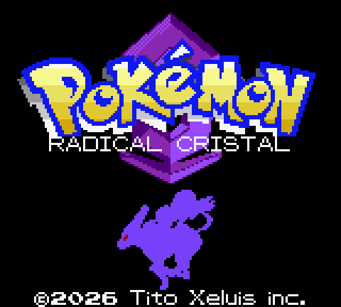

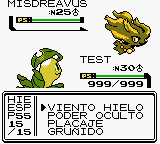

## Descarga y cómo jugar

**[⬇ Descargar Radical Cristal.gbc (v5.0)](https://github.com/Xelu94/pokemon-cristal-nuzlocke/releases/download/v5.0/Radical.Cristal.gbc)** — enlace directo al asset de la [Release v5.0](https://github.com/Xelu94/pokemon-cristal-nuzlocke/releases/tag/v5.0). GitHub sustituye los espacios del nombre por puntos en la URL; el archivo es el mismo.

Versiones anteriores publicadas: [v4.4](https://github.com/Xelu94/pokemon-cristal-nuzlocke/releases/tag/v4.4), [v4.3](https://github.com/Xelu94/pokemon-cristal-nuzlocke/releases/tag/v4.3) y [v4.2](https://github.com/Xelu94/pokemon-cristal-nuzlocke/releases/tag/v4.2).

| | |
|---|---|
| Archivo | `Radical Cristal.gbc` (2 MiB) |
| Versión | 5.0 |
| SHA-256 | `86052da1d0db6fbdeb0a3a87c784e7c8032395fe54523f6127fc7179736ad089` |
1. Descarga el único archivo `.gbc` de la Release. No hay ZIP, parches ni instalador: no necesitas una ROM base ni aplicar nada.
2. Ábrelo con un emulador compatible con Game Boy Color (por ejemplo mGBA). El emulador se obtiene por separado y no forma parte de este proyecto.
3. Guarda dentro del juego. Las actualizaciones de esta familia continúan el guardado interno (`.sav`); no uses estados rápidos de otra compilación. Detalles en [compatibilidad de guardados](docs/COMPATIBILIDAD-GUARDADOS.md).

El modo de velocidad ×2 depende de las opciones del emulador de cada jugador; no es una aceleración añadida al motor.

Comprueba la descarga (PowerShell): `Get-FileHash "Radical Cristal.gbc" -Algorithm SHA256`.

## Qué aporta al jugador

- **Nuzlocke dentro del juego.** Muerte permanente (también por veneno fuera de combate), una captura ordinaria por zona con nombre, excepciones para regalos, huevos, iniciales, intercambios y eventos. Sin supervivientes, termina la partida.
- **Combate modernizado.** Categoría física/especial/estado por movimiento, tipo Hada con resistencias actualizadas y 12 movimientos nuevos. Potencia, tipo, categoría y PP aparecen en un subpanel del menú de combate.
- **Límites de nivel progresivos** ligados a los líderes de Johto y Kanto, que también frenan la experiencia, los caramelos raros y la guardería.
- **Aleatorización por restricciones**: iniciales, salvajes, entrenadores, regalos, huevos y eventos, con topes por nivel, línea evolutiva y potencia. Sin legendarios antes del nivel 55.
- **Experiencia repartida**: participantes vivos, mitad para reservas vivas y experiencia por captura.
- **Mochila y objetos**: el tipo de objeto (MEDICINA, BAYAS, COMBATE, OTROS) se lee en el recuadro negro de la bolsa y los bolsillos forman un círculo; 99 caramelos raros infinitos; MO como herramientas (Vuelo también desde el menú del Pokémon); objetos equipados útiles; evoluciones por intercambio o amistad sustituidas por nivel o piedra.
- **Sin curas en las tiendas.** Ninguna tienda vende pociones, revivir ni curas de estado; en la LIGA, el oficial de la CALLE VICTORIA entrega una vez 8 MÁX. POCIÓN, 10 HÍPER POCIÓN y 7 RESTAU. TODO.
- **Tito Xeluis** en 22 Centros Pokémon: intercambios, recordador de movimientos, guía de evoluciones y un jefe extra tras vencer a Rojo.
- **Ulex el Ladrón**: 16 encuentros disfrazados en rutas de Johto y Kanto.
- **Superliga y otro protagonista**: una liga extra tras vencer a Tito y un rival nuevo (GOLD o CRISTAL) con tres emboscadas, un combate final y un canje.
- **Sandbox** (compilación aparte, no se distribuye como descarga): viajes, medallas, equipo y objetos para probar; incluye los mapas de la Superliga.

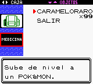 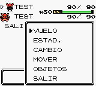
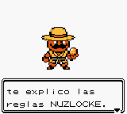 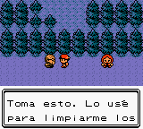

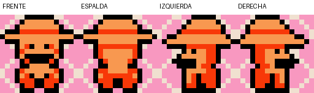

Reglas completas: [docs/MECANICAS.md](docs/MECANICAS.md).

## Retos de ingeniería

El proyecto evoluciona una base existente de ensamblador SM83 con límites estrictos de memoria e identificadores.

- **Movimientos sin ampliar la tabla.** Los 254 identificadores de movimiento ya estaban usados; nueve movimientos modernos sustituyen a otros en el mismo ID para no romper guardados ([tabla](docs/MOVIMIENTOS-SUSTITUIDOS.md)).
- **Nuevo reparto de experiencia, capturas y topes** integrados en las rutas de combate, caramelos y guardería, con una única rutina de límite (`GetCurrentLevelCap`).
- **Compatibilidad de guardados.** El inventario se amplía de 20 a 50 montones y el PC se reduce de 50 a 20 conservando los 70 espacios combinados, con migración automática de guardados anteriores.
- **Límites de memoria.** El banco 4 de la ROM está casi lleno y la WRAM sin hueco: los rótulos de la bolsa viven en una sección propia y el nivel blando del primer Ulex reutiliza un bit existente en vez de reservar una variable ([detalle](docs/ARQUITECTURA.md)).
- **Gráficos en VRAM.** El sprite de Tito se define en una cuadrícula nativa de 16×16 y se compila a una hoja de 16×96 en 2bpp con tres colores visibles más transparencia. Ulex necesitó reservar un espacio gráfico para su sprite variable en las tablas de mapas exteriores.
- **Llamadas entre bancos.** Un fallo del sandbox venía de llamar directamente a una rutina de otro banco de ROM ([explicación](docs/ARQUITECTURA.md)).
- **Randomizador sin conexión** en HTML/CSS/JavaScript sin framework: semilla repetible, manifiesto de posiciones mutables y firma de la parte inmutable de la ROM. Genera la ROM en el navegador sin enviar datos a ningún servidor ([documentación](docs/RANDOMIZADOR.md)).
- **Pruebas que ejecutan la ROM** con PyBoy (rutinas reales y recorridos de interfaz con montajes controlados) y Playwright (randomizador en navegador sin solicitudes de red) ([pruebas](docs/COMPILACION-Y-PRUEBAS.md)).

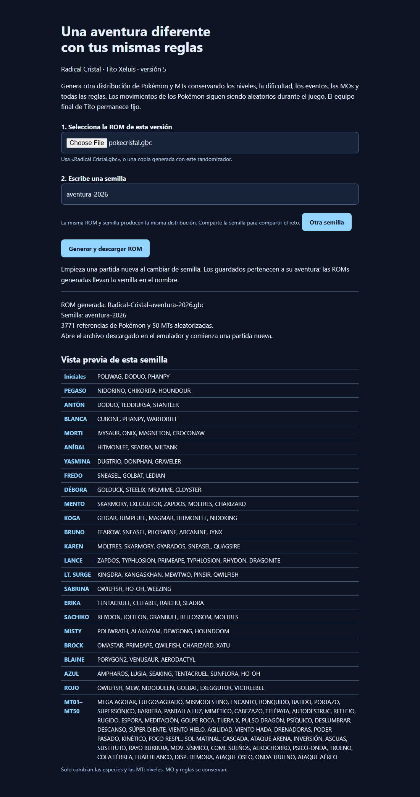

### Novedades de la versión 5.0

- **Superliga** al vencer a Tito: cuatro retadores y un campeón al nivel 100, sin muertes, con 99 RESTAU. TODO y la carta final ([detalle y diálogos](docs/SUPERLIGA-Y-RIVAL.md)).
- **El otro protagonista** (GOLD o CRISTAL) te embosca tras las escenas en que Plata solo habla, te da un último combate en la Meseta Añil y vive después en Pueblo Primavera.
- **Duelo con Elm** y tres starters shiny.
- **Dark Lugia** (Siniestro/Volador, estadísticas ofensivas) al vencer por primera vez a Tito.
- **Enfermeras Joy** en las rutas lejos de un Centro Pokémon, **piedras evolutivas** en Trigal, **bayas doradas** en vez de bonguri, **Máx. Poción** en lugar de Balls y huevos que eclosionan en 10 pasos en un shiny aleatorio.
- El aviso sobre Ulex en lugar del tutorial de captura, objetos de combate infinitos, y los arreglos de la animación de andar y de la barra de experiencia.

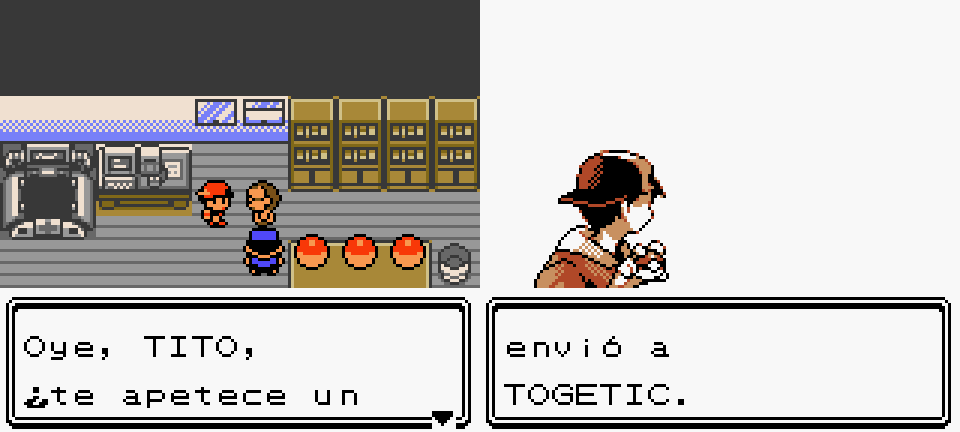
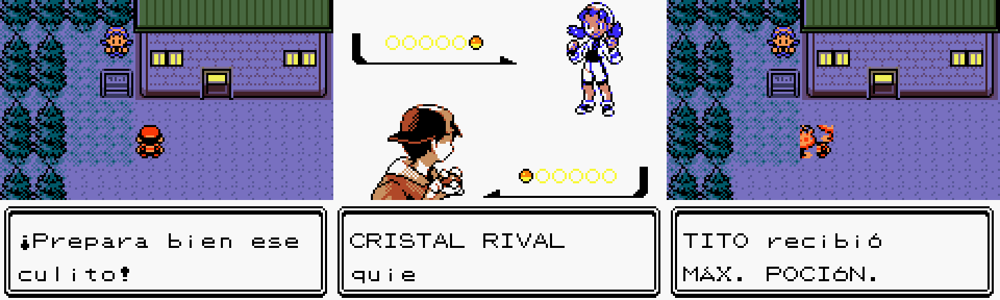
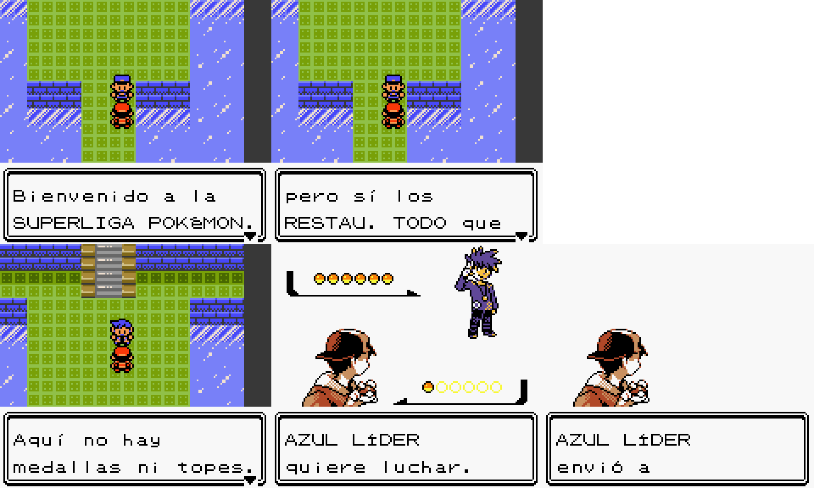
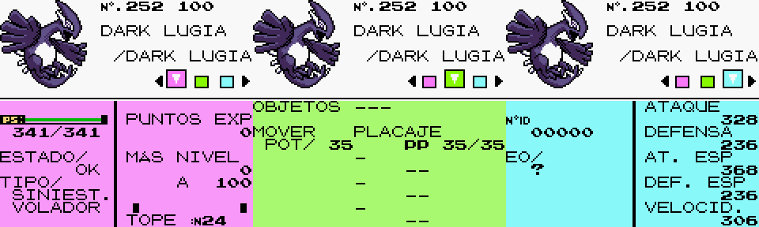
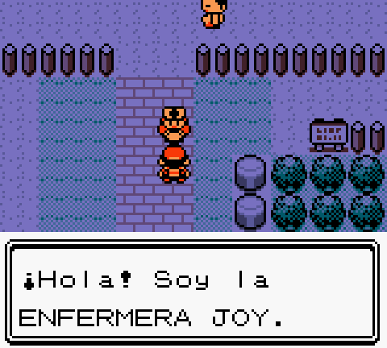

Novedades de la 4.4: tope de nivel en la pantalla de estado, iconos de categoría en el panel de ataques, rótulos en toda la mochila, Tito respira y vista previa de la semilla en el randomizador.

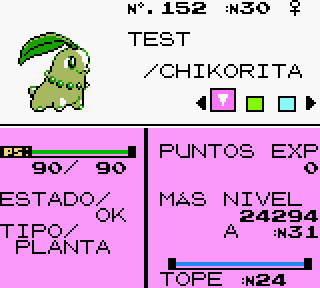 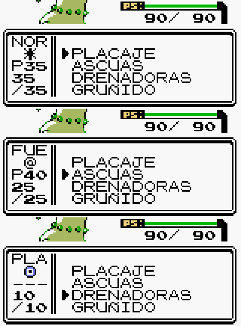
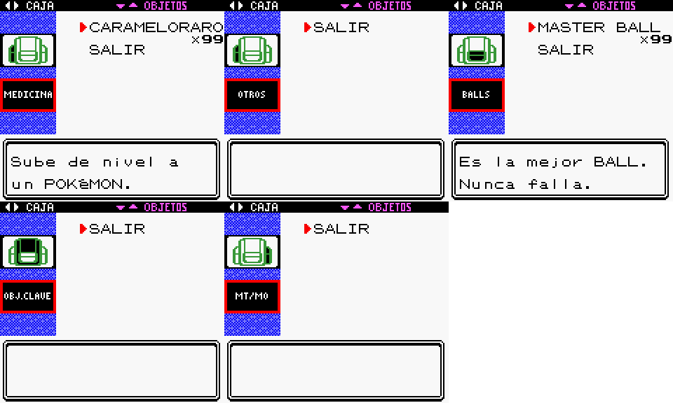 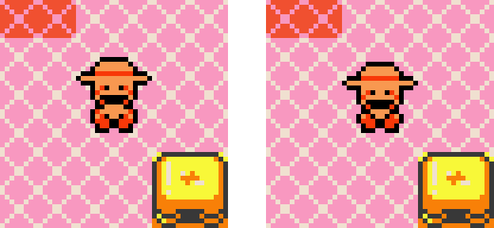

## Tecnología

Ensamblador LR35902/SM83 · RGBDS 1.0.0 (rgbasm, rgblink, rgbfix, rgbgfx) · Make y utilidades C/GCC · Python y Pillow (recursos, manifiestos, hashes) · PyBoy 2.8.1 (pruebas) · HTML, CSS y JavaScript sin framework · Node.js · Playwright · parche de fuente (git diff) y reconstrucción verificada byte a byte (SHA-256 de las compilaciones; parches BPS solo en versiones anteriores, con SHA-1 de la ROM de referencia).

No es una aplicación React, Electron, Unity ni Godot, y no usa servidor, base de datos ni cuentas.

## Estado y validación

La versión 5.0 pasó **173 comprobaciones agrupadas**: 124 de los componentes ya existentes (servicios y mapas de Tito 48, orientaciones renderizadas 4, rutas de Ulex y Objetos 17, combates de Ulex y menú sandbox 27, cálculos de combate y almacenamiento 11, interfaz real de combate y captura 4, núcleo del randomizador 9, navegador sin conexión 4), 13 de la 4.3 (Vuelo, anciano del mapa, tiendas, suministros de la Liga, caramelos y bolsa), 4 de la 4.4 (tope en estado, iconos de ataque, barra de experiencia y respiración de Tito) y 32 de la 5.0 (objetos infinitos, huevos, selector de la Superliga, aviso de Ulex, Joy, Elm, el otro protagonista, la Superliga y los datos). Es un recuento de comprobaciones, **no un porcentaje de cobertura**; algunas agrupan muchos casos (Poder Oculto se contrasta con 768 combinaciones de DVs). Las comprobaciones de informes de versiones anteriores no se suman.

La reconstrucción también está comprobada: aplicar el parche a la base española y compilar con RGBDS 1.0.0 produce exactamente los SHA-256 de la ROM normal y de la compilación sandbox de los informes.

Límites reales: los montajes omiten la introducción; algunos combates aumentan el daño para recorrer los equipos; en Ruta 17 se desactiva la gravedad solo en la prueba. No se ha completado una campaña entera ni queda demostrado el equilibrio global. El fallo móvil original de Viento Hielo no se reprodujo con el mismo emulador y guardado del usuario. La integración continua está preparada (script en [`pruebas/ci`](pruebas/ci)) pero su flujo de GitHub Actions todavía no se ha podido subir (el token usado no tiene el permiso `workflow`); hoy todo se ejecuta en local. Informe: [evidencias/Validacion-v5.0.json](evidencias/Validacion-v5.0.json).
No implementado: habilidades, megaevolución, generaciones tercera/cuarta, recursos de Prism.

## Contenido del repositorio

| Carpeta | Contenido |
|---|---|
| [`docs/`](docs) | Mecánicas, Superliga y rival, arquitectura, compilación y pruebas, compatibilidad, movimientos, niveles, sandbox, randomizador, recursos |
| [`parches/`](parches) | `Cambios-fuente.patch`: modificaciones del código fuente sobre la base española |
| [`recursos/`](recursos) | Sprites y paleta de Tito Xeluis |
| [`herramientas/`](herramientas) | Randomizador portable y sus fuentes, generador del sprite |
| [`pruebas/`](pruebas) | Scripts de validación portables, herramientas de [playtest automatizado](pruebas/simulacion) y scripts de [integración continua](pruebas/ci) |
| [`evidencias/`](evidencias) | Informes JSON de las pruebas (4.3, 4.4 y 5.0) |
| [`capturas/`](capturas) | Capturas reales |
| [`publicacion/`](publicacion) | Textos de la Release, descripción y resumen para portfolio |

Informe de playtest y equilibrio: [docs/INFORME-PLAYTEST-v4.3.md](docs/INFORME-PLAYTEST-v4.3.md). Cambios por versión: [CHANGELOG.md](CHANGELOG.md). Procedencia: [CREDITOS.md](CREDITOS.md). Licencias (MIT para el código propio, CC BY-NC 4.0 para documentación y arte de Tito; sin licencia propia para parche y ROM): [LICENCIA.md](LICENCIA.md).

## Créditos

Basado en la traducción al español de [MicaelAlighieri/pokecristal](https://github.com/MicaelAlighieri/pokecristal), que a su vez adapta el trabajo inicial de [erosunica](https://github.com/erosunica/), y en el desensamblado de [pret/pokecrystal](https://github.com/pret/pokecrystal). Pokémon y sus personajes pertenecen a sus titulares; este proyecto fan no es oficial ni está afiliado a ellos. Las modificaciones, herramientas y recursos propios (Tito Xeluis, Ulex, reglas, randomizador, pruebas) son de Tito Xeluis, apodo del autor; la marca «©2026 Tito Xeluis inc.» identifica el proyecto, no la base. Detalle en [CREDITOS.md](CREDITOS.md).
