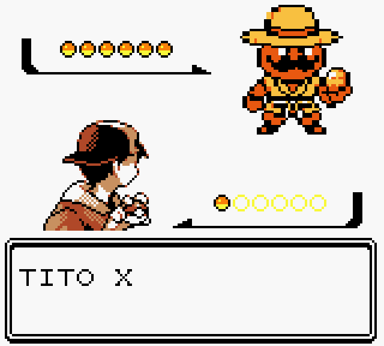

# Recursos gráficos de Tito Xeluis

## Procedencia

Los recursos de Tito parten de referencias personales aportadas por el autor del proyecto (un lienzo de pixel art del personaje: sombrero de paja amarillo con cinta roja oscura, bigote marrón curvado, ropa naranja y pañuelo crema). Para el sprite del mapa de la versión 4.2 se utilizó una herramienta de generación de imágenes para obtener una referencia con contorno y volumen, conservando la identidad del personaje, en tres poses (frente, espalda e izquierda). La **adaptación final** al formato y la paleta del motor se definió sobre una cuadrícula nativa de 16×16 con tres tonos visibles más transparencia. Por tanto, las ilustraciones no proceden de una única técnica: combinan referencia propia, apoyo de generación de imágenes y adaptación al motor.

Las referencias originales y la referencia asistida no se publican en este repositorio; solo los recursos ya adaptados.

## Sprite del mapa

- Fuente de verdad: [`recursos/tito-mapa/tito_xeluis.pixels`](../recursos/tito-mapa/tito_xeluis.pixels), una cuadrícula de texto de 16×16 por pose con los caracteres `.` (transparente), `y`, `r` y `#`.
- Vista previa: [`recursos/tito-mapa/tito_xeluis.png`](../recursos/tito-mapa/tito_xeluis.png), 16×96.
- Generación: [`herramientas/fuentes/build_tito_sprite.py`](../herramientas/fuentes/build_tito_sprite.py) (Python y Pillow). Valida que haya exactamente tres poses de 16 filas con los caracteres permitidos y escribe la hoja.
- Orden de tiles: frente, espalda, izquierda, seguidos de tres fotogramas alternos completos. La derecha se obtiene **reflejando la izquierda por hardware**. La hoja compilada mide 16×96 y usa 2bpp.
- No se reescala la hoja grande de referencia: a 16×16 se perdían ojos y contornos.

Las pruebas verifican los tiles renderizados (OAM) y su reflejo, no solo la variable de dirección.

## Retrato de combate

[`recursos/tito-combate/tito_xeluis.png`](../recursos/tito-combate/tito_xeluis.png) (56×56) y su paleta [`tito_xeluis.gbcpal`](../recursos/tito-combate/tito_xeluis.gbcpal). El retrato se conserva de versiones anteriores.

